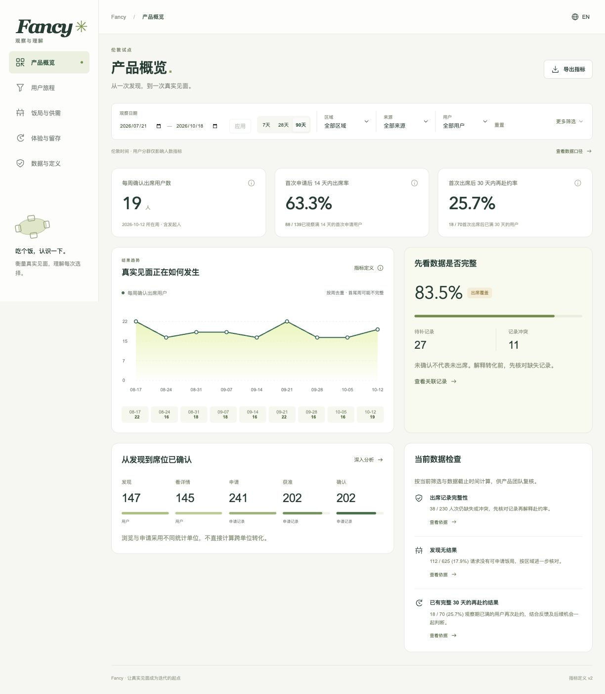
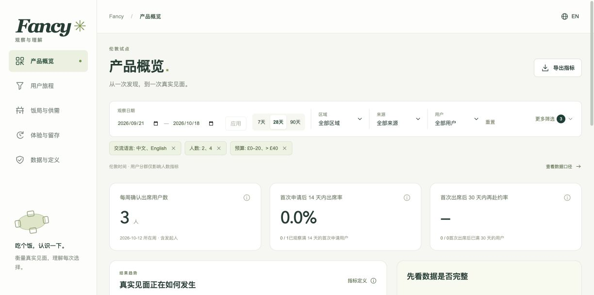
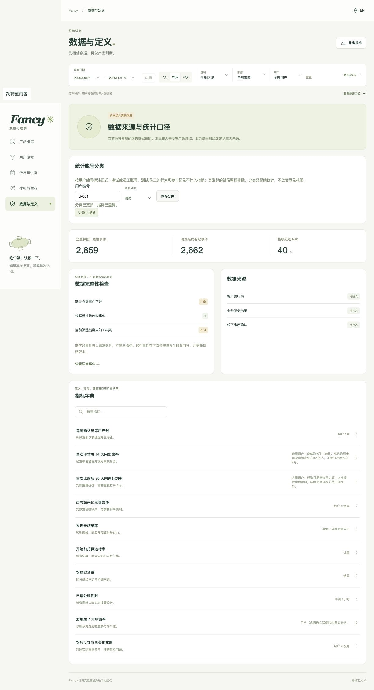
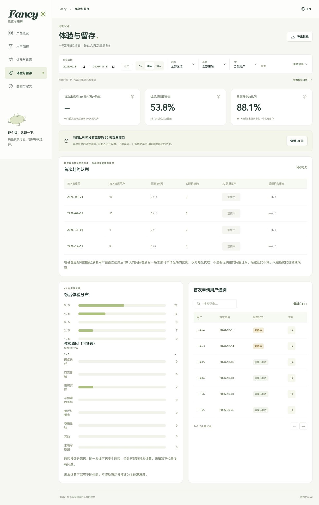
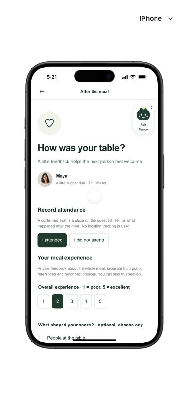
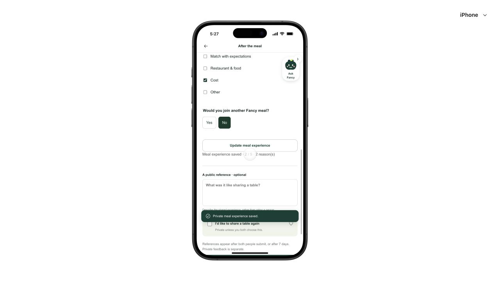
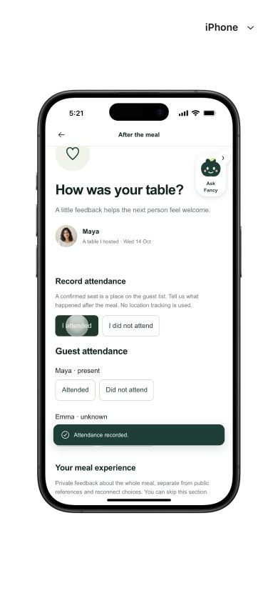

# Fancy 首期运营后台与 App 采集修订

日期：2026-10-19。范围：用户19条批注、首期运营问题与指标、App原始数据入口，以及两端PRD/原型。需求真源：[主PRD](../product/PRD.zh-CN.md)、[后台PRD](../product/admin/PRD.zh-CN.md)；详细统计与接入：[采集契约v2](../product/admin/measurement-contract.zh-CN.md)。

## 逐条处理

| 批注 | 核查/决定 | 已落实 |
|---|---|---|
| 01 无内容的产品洞察页 | workspace是装饰卡而非页面，不应造成层级误解 | 删除卡片；面包屑只留Fancy/当前真实页面 |
| 02 模拟数据备注 | 常规产品界面不应反复显示开发提示 | 删除顶部模拟徽标；真实连接状态集中到数据页与文档 |
| 03 FP头像 | 当前没有账户资料或真实内部认证 | 删除顶部与侧栏虚构身份，不增空的账户页；生产认证按PRD接入 |
| 04 示例横幅 | 与顶部备注和数据来源重复 | 删除整条横幅，数据截止与源状态留在数据页/指标/导出 |
| 05 日期图标 | 原输入过宽，应用与图标关系不清 | 收窄日期输入，独立应用边框和间距 |
| 06 语言选项 | “全部”与双语类别语义不清 | 按支持语言English/中文筛选，双语场次两者皆可命中；联合选择只计一次 |
| 07 多选 | 分析需要比较多区域/人数等集合 | 六类筛选支持多选，同字段OR/跨字段AND，URL与外部标签保留 |
| 08 预算不MECE | 原≤25与≤30重叠且无高预算 | [0,20]、(20,30]、(30,40]、(40,+∞)、未填写；预算指预计人均上限 |
| 09 测试员工账号标注 | 原只有事件排除，没有维护入口且业务事实未统一排除 | 数据与定义内按userId分类；事件/申请/参与/反馈统一排除，测试host整场排除，招募峰值剔除测试成员后重建；生产需权限审计 |
| 10 成熟用户 | 内部分析术语易误解为用户类型 | 改“已观察满14/30天的用户”，与年龄/熟练度无关 |
| 11 满14天及host漏斗 | 需完整后续窗口，不把近期者算失败；host发布不是申请 | 字典补起算与具体10月1→15日例；host开始创建→完成安排→发布单列 |
| 12 首次申请归日期 | 先找全历史首次再按日期选人 | 文案与契约明确9月入组、10月后续仍可观察，不能先截日期再找首次 |
| 13 申请记录+出席 | 是同一userId关联两种权威记录，不是两个按钮点击 | 解释提交成功≠获准；出席需有效名单与饭后报告，时间/取消/退出均校验 |
| 14 访问发现与曝光 | 成功加载不等于看见卡片 | 改发现列表加载成功/实际看到可申请饭局卡片；50%面积+连续1秒，前台可见，服务端结果与客户端曝光各自采集 |
| 15 席位确认 | 名单/付款状态不等于实际出席 | 改席位已确认，旁注明确与饭后实际到场不同 |
| 16 中位/P90耗时 | 术语难读且待审不应被漏掉 | 改审核用时50%/90%申请在此时间内处理，补起止与例子；待审单列 |
| 17 最低人数 | App已有groupReady：2人桌2人，3–6人桌3人 | 详情明确最低人数，PRD保存minimum快照；后台改开始前招募达标率，不当成真实履约 |
| 18 出席按钮 | 原App没有满足后台口径的结构化入口 | 新增本人出席/未出席与host逐人报告；饭局结束后开放，冲突不推断失约；纯函数资格校验，后台仍可核实 |
| 19 评分后原因 | 原App只有公评与针对某人的私密互选，没有整场评分 | 新增私密整场1–5评分、是否愿再参加Fancy、可选多原因；后台按评分看原因，未填写单列，公评与互选不混用 |

## 首期实用性判断

保留三项结果：每周确认出席用户数、首次申请后14天内出席率、首次出席后30天内再赴约率。诊断依次回答供给匹配、申请/响应、招募/取消、体验原因、后续机会；以出席覆盖和数据质量作护栏。没有真实基线时不增加目标涨幅、自动告警阈值、自动经营Agent或无法促成行动的指标。观察期不完整的结果单列，不靠模拟值补齐。

[采集契约](../product/admin/measurement-contract.zh-CN.md)已将后台所有展示指标映射到App入口/事件/业务表、粒度、分子分母、去重、观察期、快照、筛选、身份及权威来源，并区分已有前端路径、本轮新增入口和仍待开发的生产服务。主PRD已补共享最低人数、计划结束、出席和整场体验规则。

## 验证与证据

- 后台13条共享浏览器路径（原有10条+新增3条）全部通过，在Codex内置浏览器执行；[结果JSON](../../admin/qa/measurement-2026-10-19/browser-results.json)。Playwright包装器复用同一套场景，本轮没有另行执行CLI浏览器矩阵。
- App共享回归场景`demo/tests/post-meal-scenario.mjs`也在同一内置浏览器通过，浏览器无error；可由`post-meal.spec.ts`复跑。App实走：已有账号→Meals→Past→报告出席→2分/多选原因/No→保存；host历史饭局逐人报告；切回第一场保留评分与原因。整场体验不自动勾选私密互选。原型状态按场次隔离，刷新恢复。
- 后台23项指标/筛选/分类/结束资格的Node单测、App53项领域测试（包含新增出席/体验校验）、两端构建、28个受保护移动运行时文件完整性及仓库36项验证均通过。
- 修正连续多选时的布局移动问题：先关闭前一个内联选项会使点击目标移动，现改为点击后收起同级项，保证首次点击生效。fieldset/legend修正饭后原因与意愿的嵌套label，保持每项独立名称。

### 界面证据

## 交付边界与复盘

本轮交付的是可操作原型、清晰指标算法及生产采集规格。两端仍为独立本地数据，尚未打通真实账号、出席/反馈存储、采集SDK、权限审计、提醒或快照作业；“去开发备注”不等于宣称生产接入。连接状态在数据页和文档说明。生产应先接业务事实、出席/反馈，再接客户端曝光与交互，手算对账后用于运营决策。

复盘：本轮方法由现有产品管理、产品设计与KPI设计技能覆盖，不新增正式技能或候选，不改全局个人配置。
