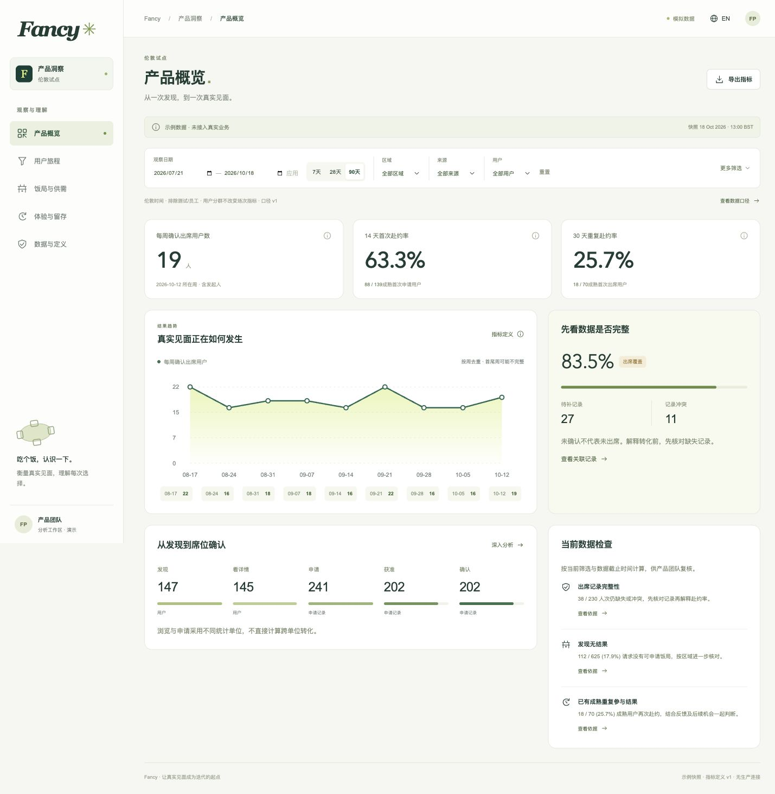
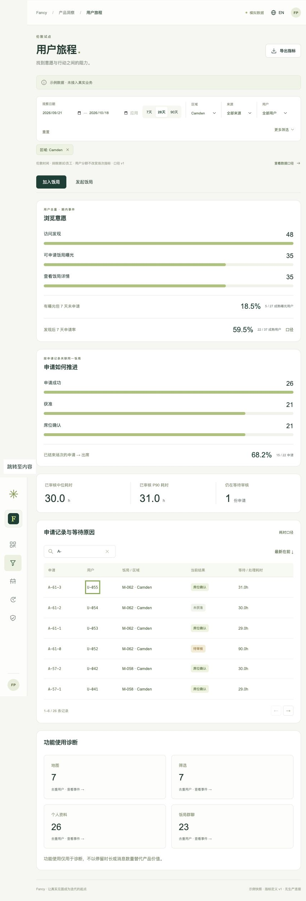
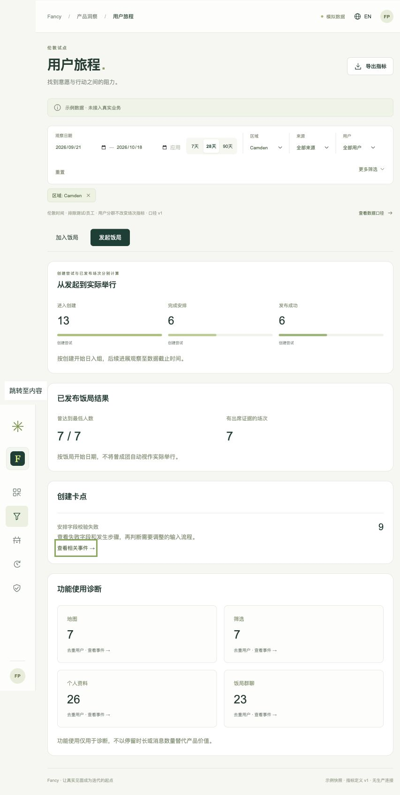
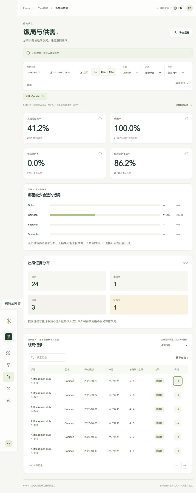
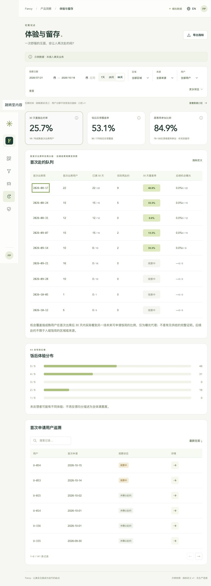
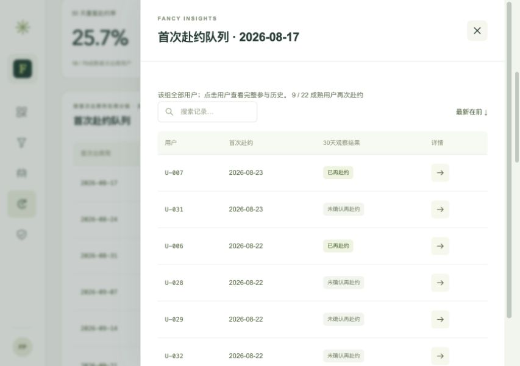
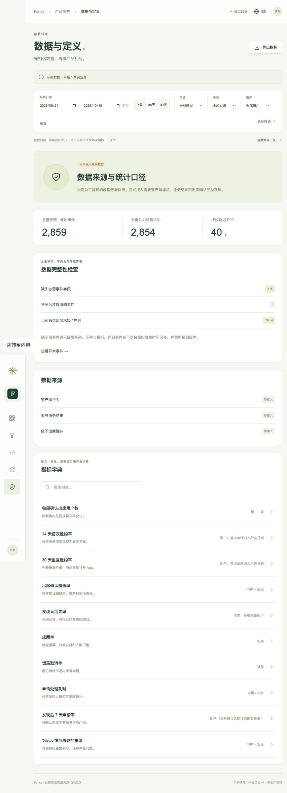
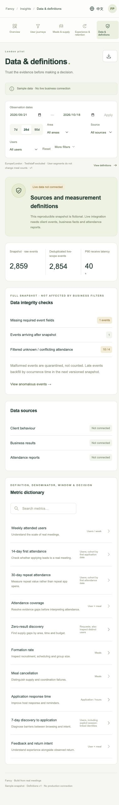

# Fancy 管理端可用性审查与修订

日期：2026-10-18｜范围：产品数据后台全部五页、加入/发起分支、筛选、详情、队列、核实、导出及空错状态。

## 结论与维护职责

已修复用户指出的筛选弹层关闭和固定议题问题，并按第一阶段的实际分析任务精简交互。保留现有视觉体系，减少装饰/教学/测试内容，不增加新的管理模块。

**没有经营分析 Agent，也没有每周自动写议题的任务。** 原“本周优先验证什么”是固定文案，甚至在90天视图显示28天尚未成熟的解释，不能作为真实经营结论。现改为“当前数据检查”：系统按同一份当前筛选/快照计算出席证据缺失、发现无结果和30天队列成熟情况，附带分子分母和查看依据入口。

第一阶段由你或产品负责人每周复核事实、确定待验证问题与产品优先级；规则由产品团队维护并经测试提交。无需逐周修改页面文案；规则随真实快照更新才会呈现新事实。当前仍为固定虚构数据，不会自动产生新一周的真实经营数据，不做因果或自动优先级判断。

## 逐页走查

| 步骤 | 页面/任务 | 当前结果 | 主要调整 |
|---|---|---|---|
| 1 | 概览→筛选→检查依据 | 通过 | 外部点击/Escape收起；隐藏条件可移除；检查随范围变化；出席问题直接筛选相关饭局 |
| 2 | 用户旅程：加入与发起→用户/饭局/事件 | 通过 | 日期排序明确；搜索随语言保留；详情有返回；发起历史补齐；时间统一伦敦 |
| 3 | 供需→区域→出席证据→饭局 | 通过 | 状态卡可筛选下方记录；聚合分母不变；分页与搜索恢复清楚 |
| 4 | 留存→成熟队列→整组用户→单人→返回 | 通过 | 队列日期不再打开任意首位用户；覆盖率与意愿分别命名；观察中不冒充流失 |
| 5 | 数据定义→异常→字典→验收模式 | 通过 | 普通页面无场景测试开关；`?review=1`支持空态/失败恢复；必要数据边界仍明确 |

## 已修复的问题

| 编号 | 证据与复现 | 问题/影响 | 修订 |
|---|---|---|---|
| F01 | 用户评论1；原生details打开后点标题/切页 | 下拉未收起，跨页面遮挡 | 共享FilterPopover处理外部指针、外部焦点、Escape及切页；内部可连续选项 |
| F02 | 用户评论2；90天概览 | 固定“本周”解释与成熟指标矛盾 | 改当前数据检查，空范围/未成熟/成熟分别计算，不冒称Agent |
| F03 | 留存队列日期 | 显示一组用户却只打开第一人 | 打开全组用户及各自观察状态，分母与同一聚合对齐 |
| F04 | 864px图标侧栏 | 文本隐藏后链接没有名称 | 增加本地化aria-label和悬停标题 |
| F05 | 留存三个核心卡片 | 两个不同的反馈指标同名 | 分别显示“饭后反馈覆盖率”“愿意再参加比例” |
| F06 | 更多筛选/语言切换 | 条件隐藏、无法直接移除，局部搜索丢失 | 条件数量+可移除标签；语言切换保留搜索与排序 |
| F07 | 列表首尾记录及切换顺序 | 原“↓”没有按真实日期排序 | 默认最新在前，明确切换最早在前；切换/结果变化回到第一页 |
| F08 | 用户↔饭局/队列↔用户 | 嵌套后只有关闭，没有返回路径 | 统一详情栈，返回上一条详情，关闭恢复初始焦点 |
| F09 | 查看发起人详情及事件 | 相关饭局漏掉本人发起场次，时间混用UTC | 补齐主持与申请历史，时间线统一Europe/London |
| F10 | 点击导出并读取CSV | 只导出3个值，缺供需/反馈等分析 | 补齐核心比率、出席分布、创建、耗时、功能人数及队列汇总；不导出原始个人记录 |
| F11 | 数据页、供需页、概览 | 测试开关/静态教学/重复装饰混在正常页面 | 测试开关只进显式验收模式，移除静态教学卡和重复眉题，必要指标解释保留 |
| F12 | 出席核实：空依据与缺原始记录 | 错误未聚焦字段；人工核实被写成本人自报 | 字段聚焦，分别保留发起人/本人/人工来源 |
| F13 | 未确认/提前退出/取消/未来场次详情 | 显示“未知”易误认为应核实缺口 | 非应确认成员显示“不适用”，拒绝非法核实保持不变 |
| F14 | 概览出席问题→记录 | 只到全量饭局，难找到实际待办 | 默认筛“待补或待核实”；供需状态卡和列表专属筛选直接定位 |
| F15 | 连续输入日期及未应用草稿 | 草稿生效时机不明确，浏览器事件处理不一致 | 原生日期统一input与函数式更新，草稿提示，未改动禁用应用，非法范围保留原图 |

此外，统一辅助说明字号与颜色、增加筛选标签和选中态，避免因两列卡片强行等高造成大块空白。没有重做品牌或增加业务权限。

## 验证与证据

- 本轮在用户已打开的 **Codex 内置浏览器** 上执行共享场景；没有另开Chrome或调用独立Playwright CLI。`admin/tests/dashboard.spec.ts`是同一套场景的Playwright包装器，便于之后复跑。
- [浏览器结果](../../admin/qa/usability-2026-10-18/browser-results.json)：10条路径全部通过，最后一轮回归没有新增浏览器error/warn。
- 视口：864×609（用户场景）、390×844、1440×1000；窄屏筛选弹层边界实测在视口内，页面无横向溢出。
- `pnpm test`：16项指标/规则测试，含新增动态检查、空范围及队列成员与聚合对账。
- `pnpm build`：TypeScript与Vite构建；仓库根Python验证覆盖内容/文档链接及索引；UI静态审查和差异空白检查通过后交付。
- 核心场景包括外部点击/Escape/切页、语言切换、搜索/排序/分页、嵌套返回、成熟与未成熟队列、证据核实与刷新恢复、正常/验收模式、空态/失败重试、日期错误、实际CSV下载并检查内容。

### 当前截图

以下为本轮保存并查看的实际截图；不同页面的筛选范围在截图中显示，不把不同筛选造成的数字差异当样式错误。

1. 概览与动态检查（90天）：

2. 加入与发起旅程：

3. 供需与证据记录：

4. 留存及整组队列明细：

5. 数据与定义（普通模式）及窄屏：

原始审查截图按01–05保存在[本轮截图目录](../../admin/qa/usability-2026-10-18/)，对应概览、旅程、供需、留存与数据页。它们是本轮修复前采集，不是历史缓存截图。

## 边界与后续

本轮证明指定浏览器、视口及本地虚构业务路径可操作，不证明真实埋点、生产鉴权、业务服务、自动周报或Agent已经接入。未做真实设备全矩阵、独立安全审计或读屏人工评估，不宣称全面无障碍合规。真实试点仍按[管理端PRD](../product/admin/PRD.zh-CN.md)完成身份权限、采集、权威结果和出席数据接入。

方法复盘：已有产品管理、交互设计及验证技能已覆盖本轮方法，没有新增独立技能候选，也没有修改个人技能或全局规则。
