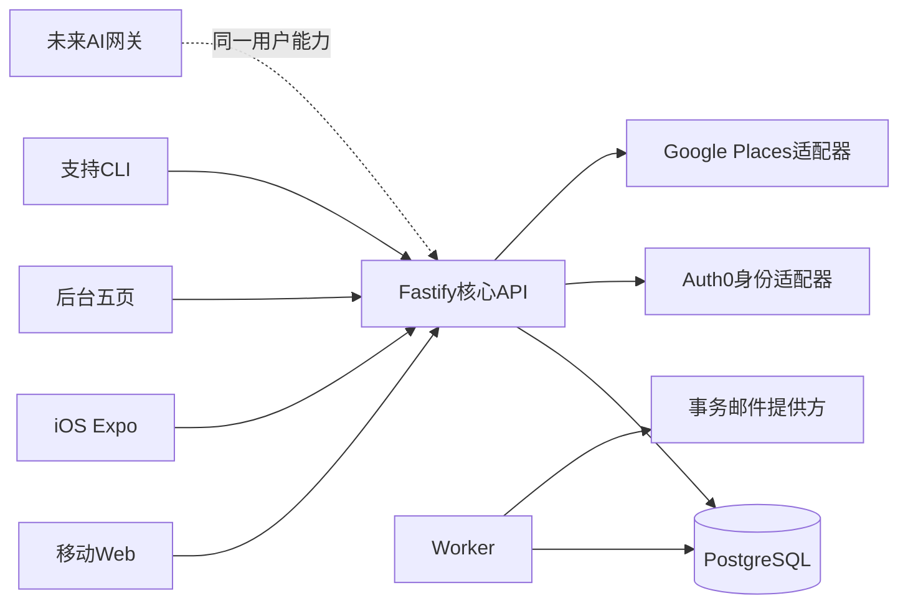

# 核心双端开发方案 v1

## 1. 用途、范围、批准与边界

这是Claude后续开发的技术执行基线，初始需求基线为`019d43c75f70ee3f5f0e89b998867bd5d494e885`中的[主PRD v0.8](../product/PRD.zh-CN.md)§0、[后台PRD v1.4](../product/admin/PRD.zh-CN.md)、[采集契约v4](../product/admin/measurement-contract.zh-CN.md)，准入依据见[独立复评](../reviews/development-readiness-2026-10-21.zh-CN.md)。本轮交付设计文档、任务和验证入口，不建设后端、不改原PRD/Demo、不部署。

设计期间原会话提交`77c91fa`与`ce74f803121de64335db318a34f2e7447e3b1c0b`，主PRD仍v0.8，增补AI规格0.2/FR-13，非AI规则及Demo未变。本包基线更新到ce74f80；AI复评见[AI研发准入报告](../reviews/ai-development-readiness-2026-10-21.zh-CN.md)。AI-B01/AI-B02在初评发现后，用户通过P-04/P-05明确决定。产品决策歧义已消除；PRD/Demo正文待原会话回填，不声称已修改。技术设计以本表新增决定为共同输入，完整AI方案见[AI技术方案](ai-development-plan.zh-CN.md)，共同认可状态以共同审查记录为准。

2026-10-21用户本轮明确决定，优先于旧文档中的待定文字：

| 决策 | 当前事实 | 本方案处理 |
| --- | --- | --- |
| P-01 | 产品包含真实AI；用户另起会话完成AI PRD | 核心不得假设AI后置于最终产品；核心T任务不承担模型实现；本轮新增AI方案及A任务定义真实接入，完整产品上线必须完成双方集成 |
| P-02 | 站内通知为权威；关键审批/取消另发邮件；iOS推送后置 | [接口与客户端契约](api-and-client-contract.zh-CN.md)定义事件/收件人/渠道，不擅自扩成营销邮件 |
| P-03 | 重复伦敦时间显式选择BST/GMT；不存在时间报错 | 开始及截止输入均用本地时间+选定偏移交服务端验证，禁止静默取后一次或平移 |
| P-04 | 用户明确选择“保存偏好仅排序，明确条件硬过滤” | 本次明确要求/会话已确认条件/Discover已应用筛选为hard；保存偏好仅soft；CLEAR抑制对应旧偏好，不恢复为过滤 |
| P-05 | 用户明确选择“host填写，允许不确定并显示未提供” | 菜系/饮食字段由host声明，可空；非Places自动保证；未知不命中特定条件，非过敏安全承诺；沿用现有字典并版本化 |

原「产品设计-MVP」会话后续把P-01—05回填PRD；该回填不阻塞本轮设计验证，因为决定已明确，但执行者必须同时读取本表，不从旧“待定”恢复另一套规则。技术选择T-01—08是本轮工程设计，不冒称用户曾指定这些技术。

**文档优先级**：最新用户明确决定 → 主PRD§0及本表新增决定 → 后台指标契约 → 本技术包 → Demo代码/历史shared。发现新的产品冲突只暂停受影响切片，不代改需求。原Demo保留后续交易参考，首期生产实现只显示外订到店付。技术方案不是修改原型的授权。

## 2. 架构选择

| ID | 选择 | 理由及约束 |
| --- | --- | --- |
| T-01 | 模块化单体：Node 24 LTS、TypeScript、Fastify 5、JSON Schema/OpenAPI 3.1 | 一套服务拥有业务事务，不拆微服务；具体补丁在T00安装时锁定，不能复制Demo的TS7/React版本要求给原生SDK |
| T-02 | PostgreSQL 17、Drizzle迁移/查询、`pg`连接池 | 事务行锁与唯一约束承载名额和幂等；生产托管Postgres供应商不影响数据契约；不新增Redis/Kafka/Elastic |
| T-03 | 移动Web=React DOM/Vite；iOS=React Native/Expo开发构建；后台=React DOM/Vite | 共用HTTP契约、SDK、规则样例和tokens，不强行共享DOM/手机模拟键盘；iOS必须真实原生构建，不能WebView充当交付 |
| T-04 | 身份适配器默认Auth0，业务自持会话与用户ID | 支持邮箱OTP/Google/Apple；不自建密码库；不自动按邮箱合并。Auth0配置与费用/地区在外部依赖门槛验证，不在本轮开账户或付费 |
| T-05 | API、worker两个进程，同一代码库与DB | 作业来自持久化表，进程重启不丢截止、消息、邮件和删除任务；worker可多副本；承载AI短期RAM的API当前固定1副本、Recreate先停后启；扩API/滚动发布须先完成AI context ADR，无分布式事务 |
| T-06 | 首期消息：HTTP发送+前台2秒增量轮询 | 进入会话立即拉取，后台暂停，失败指数退避到30秒，恢复前台先鉴权后补拉；无需先建设WebSocket，接口可将来扩展 |
| T-07 | 支持：专用有审计CLI+受限支持API | 不扩后台既定五页；创始人可授权support。报告人/删除请求人从App查询自身状态 |
| T-08 | 分析：小时级密封事实快照，所有过滤/下钻/导出绑定snapshotId | 业务事实与SDK事件分开；生产与fixture隔离；正常历史不重写，删除引发受控快照撤销例外 |

不选纯BaaS客户端直写：本项目必须把名额、时间、消息区间、同意撤回和历史修订放到可共同审查的服务事务。托管DB可使用兼容服务，但不让RLS函数、边缘函数和客户端分别拥有一套业务权威。RLS只作拒绝客户端直接访问的防线。若要改变默认栈，先记录技术ADR和对任务/验收的影响，不边实现边暗换。



图中AI虚线不是已经允许读取数据或执行动作。获准AI数据和行为现由FR-13及P-04/P-05定义，具体实现见AI方案；不包含自治工具或长期关系记忆。

## 3. 代码布局、资产复用与写入责任

以下目录是**待创建目标**，不是本轮已存在的服务：

```text
apps/api/src/{identity,profiles,venues,meals,membership,messaging,connections,post-meal,support,accounts,notifications,analytics,admin}
apps/worker/src/{runner,lifecycle,mail,analytics,deletion}
apps/web/src/{routes,features,api}
apps/admin/src/{routes,features,api}
apps/ios/{app,src/features,src/api}
packages/contracts/          JSON Schema、生成OpenAPI、响应DTO
packages/domain/             纯规则，不读取DB/网络/系统时钟
packages/db/{schema,migrations,queries}
packages/client/             生成类型+统一HTTP SDK、重试与错误归类
packages/testkit/            独立身份、时钟、Postgres fixture与手算样本
infra/                      本地compose、部署模板，不含真实凭据
```

`tasks/plan.md`是执行入口，`tasks/todo.md`是唯一任务状态表；本目录是技术真源。不把目录树复制成空壳提交。每完成一个切片才创建必要文件。

| 现有资产 | 允许复用 | 必须替换/禁止 |
| --- | --- | --- |
| `demo/src/Prototype.tsx`、CSS、设计契约 | 页面路径、文案、tokens、局部组件结构作对照 | 不整体拷贝5300行组件到生产，不迁移`?review=1`、虚构账号、固定码、模拟付款 |
| `demo/src/domain.ts,readiness.ts,postMeal.ts` | 规则示例、测试场景和术语 | 生命周期当前人数helper不是历史权威；wall-time换算必须替换为严格时区校验；域对象不直接作为API |
| `admin/src/{analytics,metrics,checks}.ts` | 公式和样本，提取可测试纯函数/可扩展SQL计算 | SNAPSHOT常量、fixture、浏览器内分类保存不能进入生产；不能由前端自报业务成功 |
| `admin/src/App.tsx`/组件 | 五页布局、图表、字典、筛选与i18n作生产适配源 | 不从静态构建暴露真实用户明细，不增加普通核实队列 |
| `demo/src/mobile/`和受保护runtime | 只供原型运行与对照 | 不改、不移、不用于原生iOS键盘/设备壳；原型测试仍须通过 |
| `shared/`旧R1 | 仅追溯 | 不接回生产，不复活旧截止/出席/删除规则 |

本轮Codex负责技术文档、任务、校验；Claude共同设计与审查、不写业务文件。后续执行由用户明确启动的Claude任务负责`apps/、packages/、infra/`；原PRD/Demo仍归原产出会话。每个执行任务声明文件清单，单一负责人，串行集成，保留竞品研究改动。

## 4. 事务、锁、时钟与事件顺序

完整定义见[数据与命令契约](data-and-command-contract.zh-CN.md)。必须遵守：

1. 认证+账户可用性检查；所有业务身份来自会话，不能使用请求体actorId。写事务在账户行取得`FOR SHARE`，删除账户用`FOR UPDATE`，防止请求检查通过后账户被删除仍写入。
2. 先读/原子声明幂等意图；**授权仍有效后**才能重放旧响应。同actor+operation+key唯一，规范请求哈希、首次响应与版本留存；payload变化409，处理中409可退避重试。普通幂等记录保留30天；客户端不重放已超过窗口的旧意图，应查询原资源；消息clientMessageId与删除requestId永久受资源唯一约束保护。
3. 锁顺序固定：相关user按ID → meal按ID → user-pair按ID → conversation按ID → 具体revision。只锁实际需要的对象，不能全局锁。定时系统命令不假冒用户。公开读用同规则的纯投影计算到期状态，不加行锁、不写库；真实补齐只由worker和单场写命令执行。
4. **拿到相关锁后**从DB`clock_timestamp()`读取`effectiveNow`；不用事务开始的`now()`裁定排队后是否仍可批准。一次领域命令使用这一个时刻；网络/提供方调用放事务外。
5. 锁内先`advanceLifecycle(meal,effectiveNow)`按计划时点和事件历史补齐截止/开始/结束，再执行命令。业务拒绝如果已补齐到期事实，应提交补齐后返回409，不能因为业务拒绝把自动取消回滚。非预期异常整体回滚。
6. 同事务写当前投影、只追加业务事件、修订、审计、站内通知/群成员授权和outbox；通知邮件/SDK分析副作用异步。群授权立即成立，不能等outbox延迟才开放或关闭权限。
7. `seat_events`记录`effective_at`、`recorded_at`、meal内单调seq；`conversation_events`统一承载JOIN/LEAVE/DISSOLVE/MESSAGE边界序号。序列号不替代时刻等号：开饭资格要求confirmedAt < startsAt且leftAt缺失或leftAt > startsAt；正好退出仍排除。
8. DB事务与HTTP超时分开。外部服务UNKNOWN不盲目重发；按提供方幂等ID或查询结果处理。自动任务唯一`(mealId,jobType,dueAt)`，重试不重复产生通知和状态。

## 5. 身份、会话和权限

默认适配器Auth0只证明身份。核心服务维护稳定UUID userId与`(issuer,subject)`映射；同一verified email发现已有业务账户时进入LINK_REQUIRED，只能证明新旧两个身份后才新增映射；取消回登录、不自动创建同邮箱第二账户，不静默合并、不把Google/Apple邮件当公开资料。Apple中继地址允许；提供方首次姓名缺失可进资料补齐。

Web：API/BFF同源，`__Host-fancy_session`为HttpOnly/Secure/SameSite=Lax随机会话cookie，服务端只存token哈希；写请求验证Origin+CSRF token。OAuth state/nonce/PKCE与允许回跳清单由成熟OIDC库处理；深链和任意returnTo不能开放重定向。邮箱在原账号页输入6位OTP，后端Auth0适配器调用passwordless start/verify，验证码不入业务日志。正式OTP有效5分钟、重发30秒、单challenge最多5次验证；提供方限制若更严，UI用实际`retryAfterSeconds`解释，不以成功假响应绕过限制。OTP/社交集成先做真凭据spike，若已购套餐不支持，报告门槛失败，不换成固定码。

iOS：系统浏览器OAuth/Expo AuthSession+PKCE；核心回调只给一次性handoffCode（60秒、绑定app challenge），app兑换自己的opaque session/refresh，不把提供方token放URL。邮箱OTP同API。会话access token仅内存，refresh由Keychain/SecureStore保存，轮换且重用撤销该session family；同源Web不把token放localStorage。应用提供方SDK与iOS开发构建在T03验证，Expo Go通过不算iOS集成。

自持session：Web随机token默认7天闲置、30天绝对上限；iOS access 15分钟、refresh 30天绝对上限。这些是工程配置，不扩充产品功能。每次请求检查session撤销与user.status；退出本设备撤销本session family并清缓存，账户删除撤销全部。敏感删除、身份合并要求5分钟内再次认证。后台复用身份但必须服务端role授权；analyst/data_admin/support按userId配置，生产后台与支持CLI要求MFA，不建设员工管理页。

资料公开投影显式白名单；公开评价仅已发布且双方仍合格才输出。发现、公开主页可游客读；未完成18+/社区确认和资料门槛不能发布/申请；失败保留原操作草稿，重新登录后重新校验状态，不能自动重放批准/发消息。

## 6. 生命周期和客户端交付

状态机和接口以本包契约为准；主PRD§0必须用真实DB集成测试覆盖。发布先有host席位事件和host群成员区间。首位guest批准永远锁定关键安排；后续所有guest退出也不解锁。`OPEN`、`CANCELLED`、`COMPLETED`为持久业务终态/阶段；`FULL`是派生展示，不另建会吞掉历史的状态。

到达closesAt：历史人数含host，pending不占位；不足minimum自动取消且待审EXPIRED。截止通过后、开始前跌破minimum，退出命令同事务取消；开始后不按减员取消。迟到worker读取截止及开始时点历史，而非当前名单。开始名单密封、计划结束=UTC开始+2小时、7天=连续7×24小时。

Web保留原型信息架构和视觉tokens，生产版独立路由与原生键盘，不能在设备模拟框里发真实消息。iOS用Expo原生页面和系统控件按相同业务路径实现，地图用合规Google地图/Places适配；前后台恢复、深链登录回流、权限失败和相同DTO均需真机验收。后台迁移到`apps/admin`，保留五页，HTTP替换fixture，更新分类以后返回新snapshotId；URL筛选和语言保留。全部客户端采用服务端allowedActions辅助显示，服务端仍独立校验。

## 7. 外部依赖与发布门槛

| 门槛 | 需要的配置/证据 | 未具备时可以做什么，不能声称什么 |
| --- | --- | --- |
| G-AUTH | Auth0租户地区/套餐，OTP/Google/Apple及回调、SMTP、身份合并/注销能力spike | 可本地合约测试；不能验收真实登录。凭据以安全配置提供，不贴聊天/公开仓库 |
| G-PLACES | Google项目/账单、Web/iOS凭据限制、地点检索、照片署名、缓存/持久化许可表 | 允许测试fixture适配；不能称任意真实餐厅接入。不得把Google内容永久快照到DB或沿用Demo示意地图显示真实Places |
| G-MAIL | 已验证发信域名、事务邮件提供方、退信/投递回调与去重 | outbox测试可做；真实关键邮件必须测试收件箱确认，不能只看provider accepted |
| G-IOS | Apple开发者/Bundle ID/签名、回调、构建环境及TestFlight证据 | 可模拟器开发；不能声称上架或完整原生交付 |
| G-PRIVACY | 公开隐私/社区条款，年龄声明，保留/清理与备份恢复删除台账的负责人批准 | 数据保留天数不得从旧shared的90天/12个月照搬；开发fixture可做，真实用户试点上线前必须配置生效 |
| G-HOST | API单副本/Recreate且重启会话失效证据，环境、域名/TLS、托管Postgres17、备份恢复、日志告警、运营支持凭据和预算 | 本地核心可完成；不自动开付费资源/部署/发布 |

门槛不是要求用户现在把所有凭据交来；它们是执行任务中明确的外部依赖。任务状态`blocked_external`和`done`分开，Mock通过不能关闭真实集成门槛。核心完成不等于包含AI的最终产品可发布，最终AI PRD/契约与联调是独立发布依赖。

## 8. 实施入口与验证

按[tasks入口](../../tasks/plan.md)启动，[任务表](../../tasks/todo.md)逐片实施；详细定义还需读取[数据与命令](data-and-command-contract.zh-CN.md)、[接口与客户端](api-and-client-contract.zh-CN.md)、[验证与发布](validation-and-release.zh-CN.md)。双人设计审查证据见[共同审查](collaborative-review.zh-CN.md)。文件分工、依赖、验收、测试与门槛明确后，Claude才能在获用户启动授权后开发。

## 9. 官方来源与适用性（2026-10-21核查）

以下支持能力/约束，不把官方示例等同本项目实现或供应商费用承诺：

- [Fastify5迁移](https://fastify.dev/docs/latest/Guides/Migration-Guide-V5/)：支持现代Node、路由完整schema；T-01据此选择显式请求/响应schema。
- [Node发布线](https://nodejs.org/en/about/previous-releases)：选受支持的24 LTS，任务开始锁定补丁。
- [Postgres17行锁](https://www.postgresql.org/docs/17/explicit-locking.html)：事务行锁为本方案串行化局部资源的基础。
- [Auth0邮箱OTP](https://auth0.com/docs/authenticate/passwordless/authentication-methods/email-otp)、[Expo集成](https://auth0.com/docs/quickstart/native/react-native-expo)、[token校验](https://auth0.com/docs/secure/tokens/access-tokens/validate-access-tokens)：支持身份适配方向；实际套餐、嵌入OTP和回调仍有G-AUTH验证，不自己实现OIDC协议。
- [Auth0身份链接](https://auth0.com/docs/manage-users/user-accounts/user-account-linking/link-user-accounts)：链接前要证明双方身份；核心映射不依赖email自动合并。没有宣称管理API免费可用。
- [Supabase链接策略](https://supabase.com/docs/guides/auth/auth-identity-linking)：默认同邮箱自动链接与本项目显式确认不同，因此不选其默认链接行为作为业务权威。
- [Expo认证集成](https://docs.expo.dev/guides/using-authentication/)与[AuthSession](https://docs.expo.dev/versions/latest/sdk/auth-session/)：部分能力需开发构建、PKCE/回调和安全本地凭据；不以Expo Go替代验收。
- [Google Places政策](https://developers.google.com/maps/documentation/places/web-service/policies)：placeId与其他内容缓存权利不同，真实Places在Google地图显示且须署名。G-PLACES必须产出字段许可表；本方案不声称长期保留地址/坐标天然被允许。

- [Auth0用户删除](https://support.auth0.com/center/s/article/how-to-remove-inactive-users)及[刷新授权撤销](https://auth0.com/docs/secure/tokens/refresh-tokens/revoke-refresh-tokens)：提供方清理要单列步骤，不把业务session撤销当供应商删除完成。
- [Apple TN3194](https://developer.apple.com/documentation/technotes/tn3194-handling-account-deletions-and-revoking-tokens-for-sign-in-with-apple)：Apple授权撤销需要相应token与流程，G-AUTH须证明实际适配能力。
