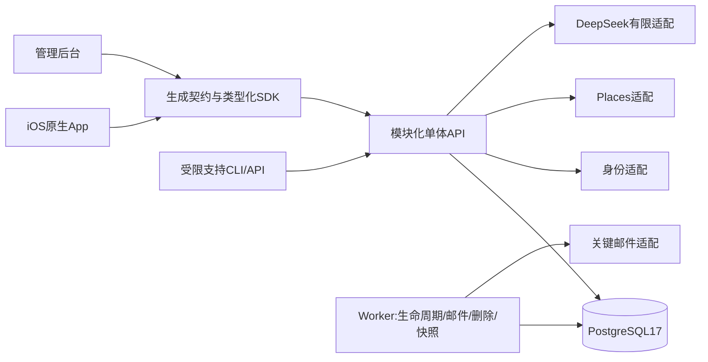

# r10 整体架构与模块协作

本轮只做RD准备。产品范围和开发迭代由PJ登记；技术模块/工作包见[module-work-packages.json](module-work-packages.json)，固定读取输入见[input-manifest.json](input-manifest.json)。技术选型理由见[选型文档](technology-selection.zh-CN.md)。旧PRD、Demo、旧Figma与业务代码未改，旧MVP/补丁环境不重启。

## 1. 一套业务权威，独立客户端

客户端的页面状态不是业务权威。API拥有会话、资源权限、时间/版本/名额判断；DB事务拥有可重放命令及业务事实；worker仅执行已记录且幂等的异步工作。内部分析读取密封快照，不能重新从客户端计算正式分母。支持操作在case授权下追加修订，不与普通分析读取混权。

AI依赖本地API进程RAM的当前设计仍保留：最少上下文、设备会话与epoch检查，不把正文持久化到分析库。当前API不采用未验证的多副本滚动接管；扩容或滚动重启前先设计会话/在途费用责任交接，不临场引入Redis来掩盖状态丢失。

## 2. 模块接口与数据权威

每个模块既包含业务行为，也可有iOS/后台适配；技术任务可以小，用户交付结果不能只剩“表/接口/按钮”。所有接口沿既有operation registry，本文按能力命名而非编造新的HTTP路径。精确method/path/schema由后续工作包读取同一提交的`packages/contracts/src`生成。

| 模块 | 对外小接口与职责 | 权威、不变量和主要消费者 |
| --- | --- | --- |
| Identity | authenticate / refresh / reauthenticate / revoke；身份链接与原意图回流 | server session→userId；OTP/OAuth一次消费，不按email合并，账号切换清旧私密draft；J01/J05/J08及内部角色 |
| Discovery | public meals / venues / filters / public profiles | 公开白名单投影，无私密评分/单方意愿；budget/host声明依PRD；查找与Places失败≠0结果；J01/J02 |
| Hosting | publish / editArrangement / declareBooking / cancel | meal/booking声明版本，伦敦时区显式offset，首批准后关键字段锁；不代订位；J02 |
| Participation | apply / withdraw / approve / decline / leaveSeat / advanceLifecycle | 用户→meal锁，名额/截止以锁内DB时钟，Pending不占位，确认事件及开饭名单历史；J01/J02/J03 |
| Messaging | list/receive/send / markVisibleRead / leaveGroup / dissolve | membership区间并集，读历史与未来发送分别授权，退席≠退群；文本与通知读位分开；J03/J04 |
| PostMeal | attendance / experience / reference / reconnect / revoke / block | 三类对象分存；本人优先/host补缺，7天连续UTC；组合保存逐项结果，不伪造跨API原子性；J04 |
| Profile | public profile edit / analytics choice / product survey | 资料、可选统计、产品问卷各自版本；问卷不挂mealId，不要求出席；J05/J06 |
| Assistant | query / explain / draft / transfer / preferences / lifecycle | hard/soft/CLEAR、数据白名单、生成不业务写；目标编辑器再次验证；预算/epoch与UNKNOWN责任；J01/J02/J03/J05/J08 |
| Safety | report / own reports / deletion request / receipt status | 举报按本人投影；删除先同步撤权屏障再202，receipt最小查询，不恢复业务登录；J07/J08 |
| Support | case facts / appendCorrection / publicOutcome / audit | MFA＋case范围；窗口外支持追加，不读取无关私密材料、不直接SQL覆盖；J09 |
| Analytics | collect allowed events / sealSnapshot / aggregate / drilldown | 可靠业务事实、适用同意、去重与snapshot/asOf/definitionVersion；分类/删除影响；J10 |
| ClassificationExport | classify / queryOriginalIntent / refreshStatistics / export / authorizedDownload | 每subject接受revision与快照输入绑定；UNKNOWN阻断旧统计，分类已接受失败仅重试统计；隐私撤销后旧票据永久拒读；J11 |
| Notifications | in-app business event / mail dispatch receipt | 业务事件＋收件人＋渠道唯一；站内业务通知与聊天未读分开，关键邮件UNKNOWN先查原次；跨J01—J03/J08 |

`packages/assistant`承载已存在的纯AI规则与排序。其他纯规则当前分布在各模块，不能因旧方案画了`packages/domain`就先抽一层通用平台；仅当两个真实消费者需要时再设计清晰接口并定向迁移。

## 3. 最重要的跨模块契约

1. **命令与锁序**：user按ID→meal→pair→conversation→revision；锁后DB`clock_timestamp()`得一次effectiveNow，补生命周期再判断命令。客户端时间、旧卡名额或当前成员数不能倒推出历史资格。
2. **幂等与未知**：actor＋operation＋原意图key＋payload哈希；读取/重放仍重新授权。结果未知查询原次，不新建意图催结果；消息与删除有资源级长期唯一约束。
3. **参与与消息**：批准直接Confirmed并开群区间；退席释放席位但不退出群，取消/结束不自动关群。退群后只读授权历史，无实时名册/空档元信息。
4. **饭后与联系**：评分、公评、再约选择各自保存；OPEN取消需先确认，部分成功不回滚或重发成功项。撤回/拉黑、合法出席纠错与直接发送共用授权权威；另一有效共同依据不能误伤。
5. **删除与隐私**：user删除屏障同步撤业务session、公开投影、未来席位/联系/群区间、AI epoch及受影响快照/旧导出访问，再受理；供应商/物理清理异步步骤不冒称已完成。隐私删除不同于普通支持修订。
6. **分析与导出**：页面/下钻/CSV统一snapshot/filter/asOf/definition；subject接受revision必须被实际封存输入覆盖，不能比较全局最大revision猜本次完成。CSV授权每次重验，不承诺撤回磁盘已下载字节。
7. **AI与人工操作**：模型只输出受schema约束的候选/草稿，所有目标/版本/资格重验；本人主动转入与提交。CNY准入账本按已批准决定执行，不能用UI“额度耗尽”替代实际预留/结算。

## 4. 版本实施顺序与并行

[PJ固定r10版本计划](../../delivery/development-versions-r10.json)：iOS dev.1(J01/J05)→dev.2(J02)→dev.3(J03/J04/J06)→dev.4(J07/J08)；支持dev.1(J09)、后台dev.1(J10)/dev.2(J11)。本技术包不修改这一范围。input-manifest固定id/product/journeys/依赖的投影，状态字段可继续更新；若范围投影变化，必须复核受影响工作包，不猜新产品号。

先完成共同契约/视觉组件Ready检查和最小可启动骨架，再在每个版本内逐模块交端到端结果。不是先建全部DB、再全部API、再全部UI。dev.1可用明确合成host前置完成申请，dev.2必须和dev.1联验真实发布→申请→审批；合成前置不等于首发通过。J03/J04在同一开发迭代内仍各自目录、各自输入与验收，问卷保持独立对象。

后台设计与只读实现可在固定统计契约下并行准备；真实分析与删除/纠错/分类传播在相关业务版本齐备后联调。支持接口按最小case能力实施，可用受限CLI/API，不因UX示意画面额外建设客服平台。

### 共享写入租约

- `RD-CONTRACTS`：contracts schema、OpenAPI、客户端生成元数据；同一变更原子生成、检查，其他worker只提交接口变更请求。
- `RD-DATA`：全部迁移、DB schema/index及迁移顺序。业务worker可写其模块API/原生UI，但不能各自抢同一schema或迁移编号。
- `RD-SDK`：非生成SDK、通用错误与重试；新行为受接口兼容测试保护。
- `RD-PLATFORM`：根lockfile/配置、API注册入口、worker main、iOS AppRoot/services、全局导航/公共UI。领域worker只改已分配的局部目录，公共入口接入由此writer串行集成。

上述为需要PJ分配的**角色槽位，不是假称已有实施负责人**。实际owner、分支/worktree、文件白名单与租约未填前工作包不可开工。共享文件冲突不能靠agent数量、Git分支名不同或“只加一行”绕过。

## 5. 设计Ready与代码开工

对应版本每个旅程均需：有效PRD/Demo输入hash、与批准MVP视觉基线一致的Figma入口/组件规范、正常及必要失败恢复/字段/权限映射、具体候选/命名版本或可核对冻结记录、UX作者交接和PJ视觉/流程核对，以及RD可实现性/接口差异已闭合。上一批被用户否定的UX-r01不满足该门槛。

这不是新增产品范围审批。PJ在用户现有授权内，将Ready的**指定版本＋指定模块**签发给唯一owner；不因某版Ready而启动后续版、全后台、Web或上线。当前全部工作包`not-issued`、Figma/代码实施gate=false；RD-preparation已开展不等于RD-code已开展。设计发现实质规则冲突回原PM，布局细节由UX解决，不由开发猜。

## 6. 隔离、验证与环境责任

未来每个活动开发候选绑定base SHA、受审diff、契约hash、迁移head、Figma引用、配置schema/非敏感配置hash与合成fixture ID；发布/build/runtime使用独立字段，不能把package版本当已安装二进制。

- iOS与后台领域任务可在不交叉文件集合中并行；集成由PJ安排统一候选，禁止多worker同时写Git索引。共享schema/生成/lockfile按租约串行。
- 不复用旧MVP/补丁数据库、会话、账本、全局时钟或供应商开关。每个正在测的候选使用独立DB名称/角色/数据、端口及PID/CWD记录；同一兼容组合只保留一个标准集成环境，不为每个小模块复制完整平台。
- 启动前预检工具链/锁文件/端口/DB版本与owner marker，给出一条受控启动命令和非敏感合成账号入口。旧localhost、原生bundle、默认DB与历史QA适配不是可复用凭据或事实。
- 环境owner最多15分钟或3次同类失败后停止同路径重试，交PJ：失败命令、错误摘要、已查证项、无数据改动证据、最小下一步；QA只接已预检成功的候选，不现场安装工具、改权限、调账本或换框架。此为工程排障约定，不是产品SLA。
- 验证从模块公开接口的规则/命令/DB测试，继而当前客户端路径，再验跨模块关键交接；同版通过后不无理由反复全量运行。供应商和真机门槛不以mock替代。
- 后续可用现有脚本：`pnpm core:check`、`pnpm core:test:unit`；DB/API测试仅在独立fixture环境显式指向目标后运行。iOS组件`pnpm --filter @fancy/ios test`；后台`pnpm --filter @fancy/admin test`。脚本存在不表示本轮已执行或将来必过。

## 7. 迁移、恢复与首发集合

先盘点当前main与封存/补丁的可复用差异，逐项记录源SHA/文件/原测试与待补验证；不整枝合入P1.1，不复制旧overlay、构建产物或QA observed-clock工具为生产行为。DB单writer按实际head分配新迁移序号，先兼容扩展再切换读写、后续独立收缩；迁移/代码回退分开，不删库回滚。已接入真实数据时必须有可实测备份恢复和隐私撤销防复活方案。

内部dev迭代不是App Store首发：iOS 4次开发迭代＋支持能力与真实身份/Places/AI/通知/删除/签名/政策等门槛闭合后，才形成IOS-0.1.0首发候选。后台两次迭代及分类/纠错/删除/导出联调形成ADMIN-0.1.0候选。任一源码完成、画板齐全或测试退出0都不自动允许提交商店/部署。
