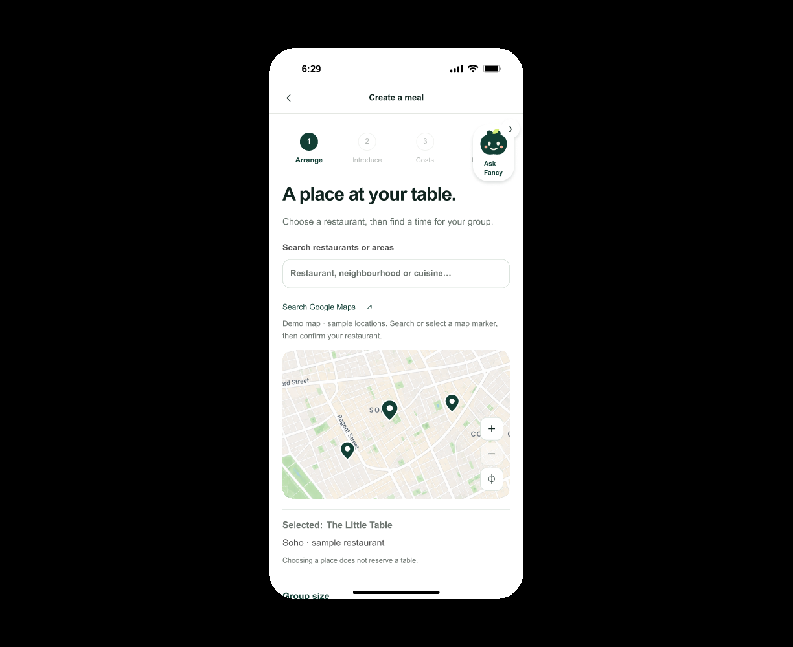
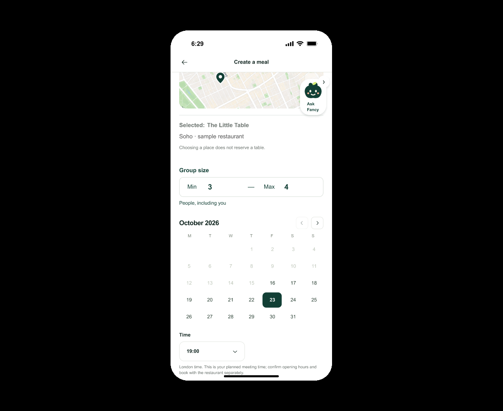
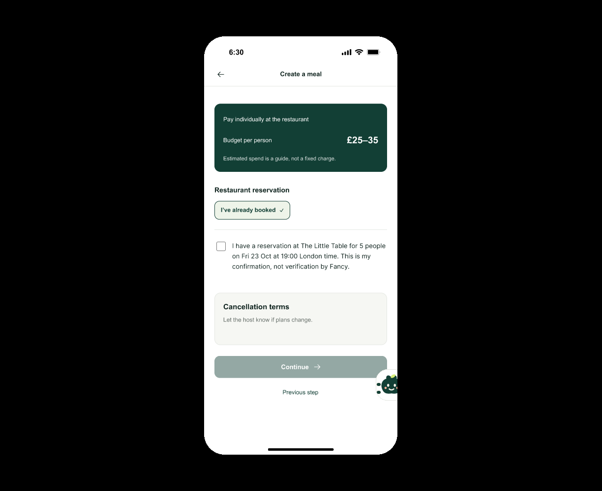
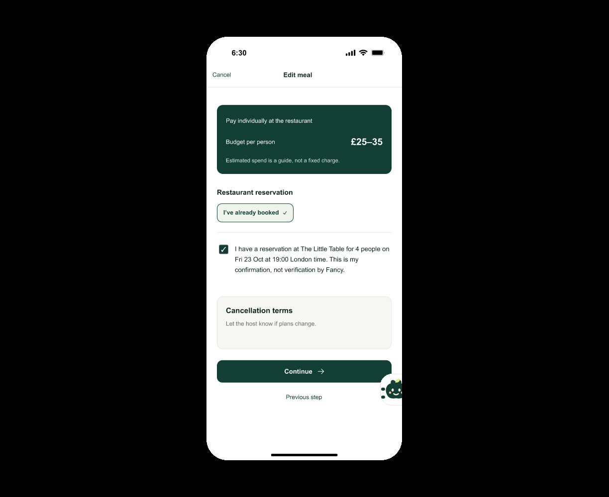
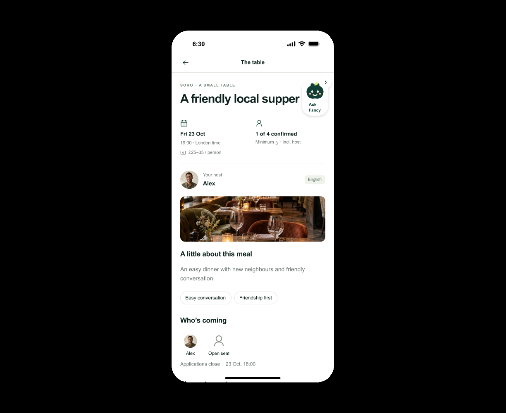
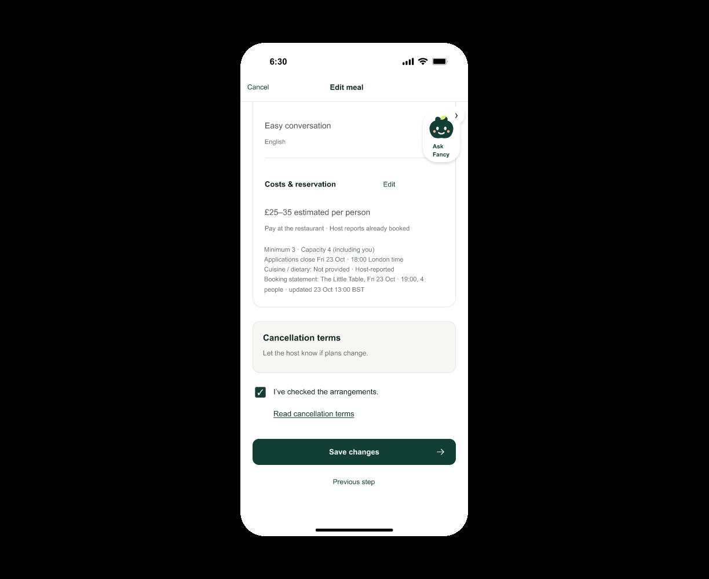
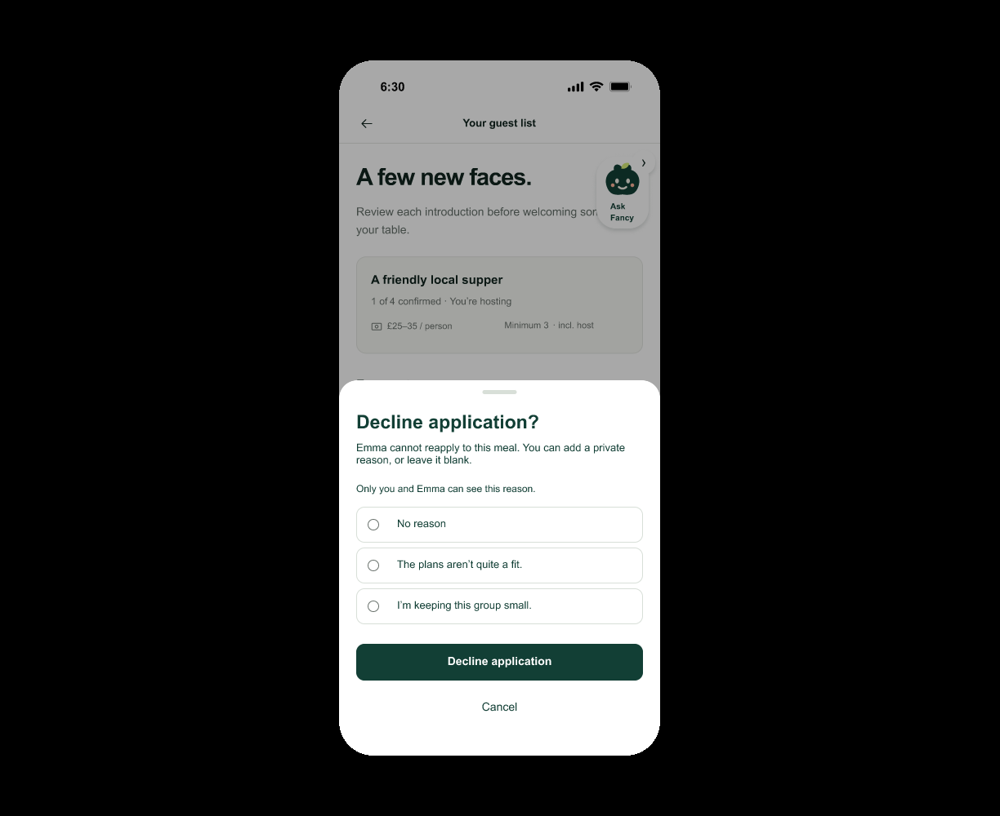

# iOS dev.2 本地浏览器实际补测

由总PJ独立于原UX执行。以下是实际鼠标/滚轮动作；Figma读回和文档测试另外记录，不能充当点击通过。仅覆盖固定样例，不代表真实服务或原生iOS验收。

[打开创建入口](https://www.figma.com/proto/c04Fi5iarZm7gTPw4u2f7f?node-id=1-24&starting-point-node-id=1%3A24&scaling=scale-down&content-scaling=fixed) · [打开申请处理入口](https://www.figma.com/proto/c04Fi5iarZm7gTPw4u2f7f?node-id=1-880&starting-point-node-id=1%3A880&scaling=scale-down&content-scaling=fixed)

## C14

Create map uses three small location pins rather than numbered meal-count clusters.

- From1:24 click map pin601,634→3:2492 Choose a restaurant
- Observe The Little Table sample candidate; click Use this restaurant610,775→1:24

Actual pin opens confirmation sheet and returns selected sample restaurant; not real Places/provider execution.

## C15

One compact Group size outline containing Min3—Max4 and one People including you helper, replacing separate large fields.

- Open range from visible Min511,454→90:399
- Attempt Max2 while Min3: invalid attempt warning, confirmed values unchanged
- Choose Min2 and Max5→Use range610,865→1:24; actual scroll shows2—5
- Reopen→attempt Min6 above Max5: warning; actual screenshot after browser repaint shows still2/5
- Choose Min4 then Cancel742,577→1:24; scroll shows original2/5
- Continue Arrange→Introduce1:340→Costs1:449: declaration now for5 people
- Explicitly check reservation→4:164→Review1:594: Minimum2 / Capacity5 and booking5
- Explicitly check arrangements→3:2365→Publish→1:719:1of5 confirmed

Create-range valid changes, invalid guard, Cancel and downstream Review/booking/publication all preserve the selected sample range. 独立版本PJ实际验证编辑Cancel保留原3–4、Save提交新2–5，见独立评审。

## C16

Actual Costs receipt amount £25–35 has visible ~18px right inner padding and aligned baseline.

视觉对齐项，不伪造业务点击。

## C17

Actual requested Edit Costs56:857 after mouse check and scroll has centered white tick within square, aligned to description first line, with amount inside receipt padding.

- Open explicit Edit Costs precondition56:725
- Scroll430; unchecked Continue610,748 stays56:725
- Click checkbox449,502→56:857; scroll430 and observe centered checked state
- Continue610,748→56:990 Review

Exact requested edit source checkbox toggles and preserves explicit progression gate; no backend effects.

## C18

Roster avatar32px smaller than host44px; final public Alex profile preserves known public bio/interests/language rather than false empty placeholders.

- Published1:719 roster460,827→92:363 Alex public profile
- Back449,151→1:719; final profile fresh-loaded separately after author data fix

Correct public identity, no private contact or unsolicited DM action.

## C19

Actual requested Edit Review56:1111 and disabled56:990 both display Save changes on one line entirely within button; exact56:1111 full-scene checkpoint captured after fresh load, not only a partial repaint.

- From56:725 checkbox→56:857; Continue→56:990
- Click disabled Save610,780: remains56:990
- Explicit arrangements checkbox449,677→56:1111
- Actual scroll to button; click Save610,780→1:719
- Fresh56:1111 is an explicit checked-state visual precondition for full-scene screenshot; not substituted for upstream gate test

Save stays disabled before consent; explicit Save returns Published with Your changes are saved and1of4 for the fixed sample. No real backend persistence claimed.

## C20

Optional three-choice decline sheet with fixed equal native rings; private recipient notice; receipt safely below application text, without overlap.

- Explicit Pending1:880 precondition; Decline530,669→94:373
- Choose Small600,743: exactly one dot; Confirm610,811→6:185 with Host’s reason: I’m keeping this group small.
- Fresh Pending; Decline→Plans600,693→Cancel610,866→Pending1:880 unchanged
- Reopen Decline: all three rings unselected, same size; Confirm610,811 without selecting→6:185 No reason provided.
- Open recipient reason94:497 and null/legacy94:513 as explicit read-only role fixtures, not simulated cross-account delivery; full canvas repaint confirms title, receipt and privacy

Selection/Confirm, Cancel/no write, no-reason/default reset actually executed. Real notification, auth, API and persistence not exercised.

## 边界与补充

创建范围2–5的确认、非法值、取消、下游发布均为实测；编辑范围保存/取消已由独立PJ实际补测通过；C13跨版本标签也已实看，证据以[独立评审](feedback-21-independent-review-2026-10-28.md)为准。C04/C05的dev.2最终首屏和名单也已实看。

Browser Use网络和额度失败不计为通过；本次成功证据来自既有本地Chromium。首次加载/局部重绘不当作产品缺陷或通过图，采用完整重绘截图。两张申请者原因回执为直达只读角色样例，并非真实通知送达。真实拒绝原因字段仍须按[PM增量](../../product/r12/ios-feedback-requirements-2026-10-28.zh-CN.md)补后端契约。
